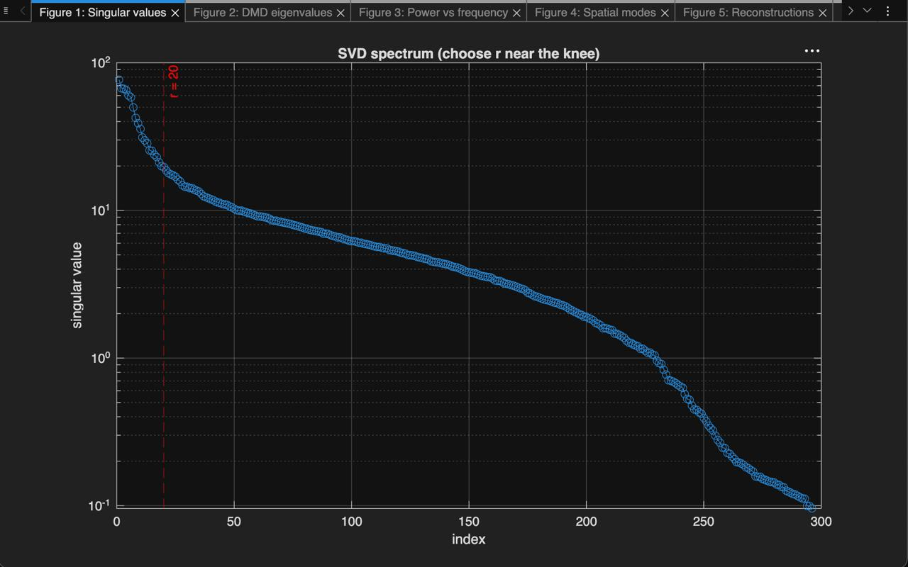
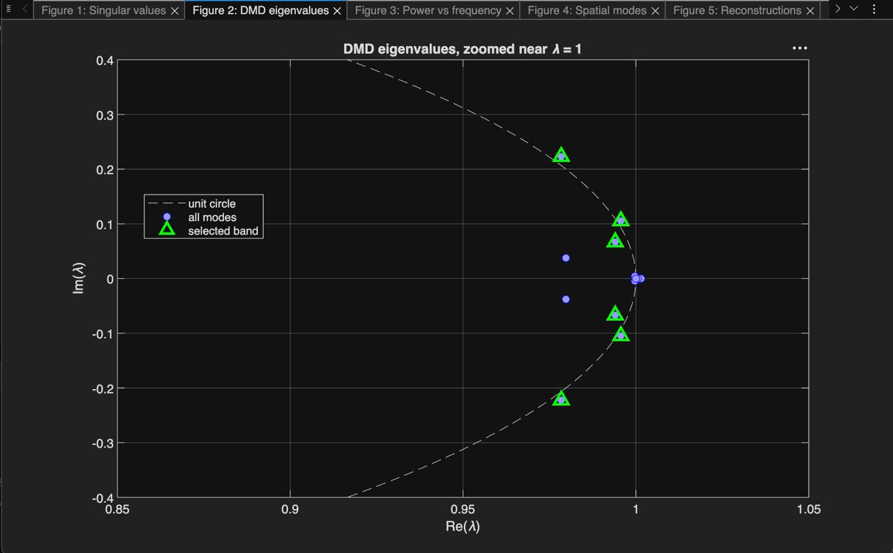
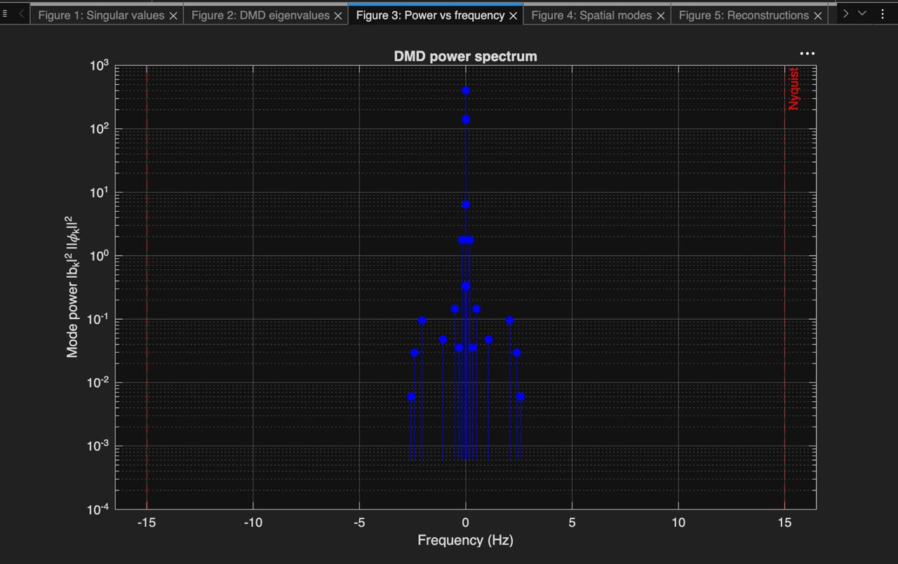
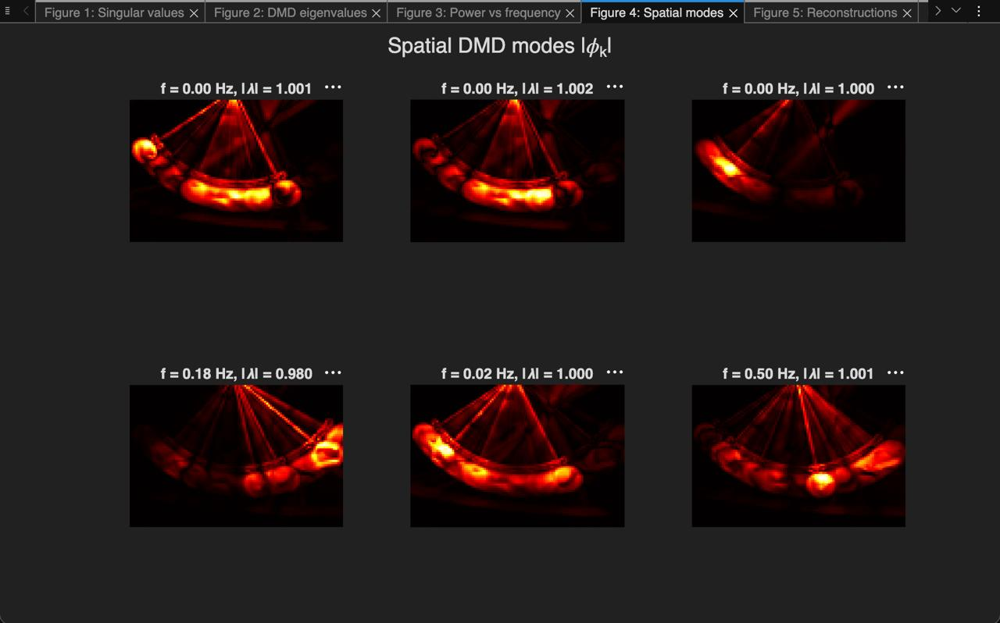
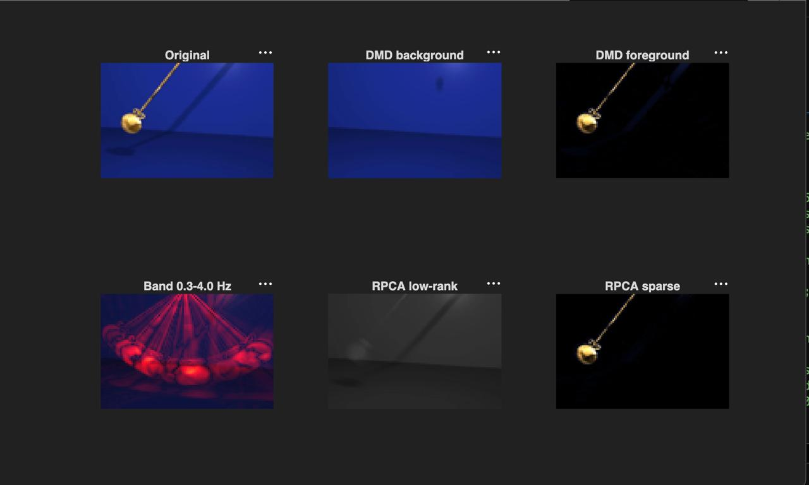
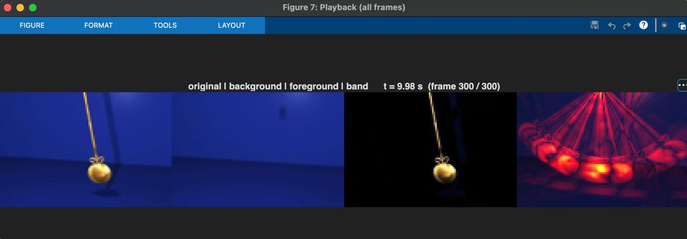

# DMD Video Separation

Dynamic Mode Decomposition (DMD) on video to separate the static background from the moving foreground, isolate a chosen frequency band, and compare the result with Robust PCA. MATLAB implementation.

## What it does

Given a short video, `DMD_VIDEO.m`:

1. Converts frames to grayscale, downsamples them (memory), and stores each frame as a column of a data matrix.
2. Subtracts a per-pixel static background image (median over time by default).
3. Runs exact DMD on the residual with time-delay (Hankel) embedding and a forward-backward correction that removes the noise-induced damping bias. This gives spatial modes, an oscillation frequency and a growth rate per mode.
4. Reconstructs the background (the static image), the foreground (the residual) and a selected frequency band.
5. Runs Robust PCA (inexact augmented Lagrange multipliers) on the same data for a low-rank + sparse comparison.
6. Writes side-by-side result videos (original | background | foreground | band) in grayscale, colour heat overlay, and sharp full-colour versions.

If the input file is missing, the script generates a synthetic demo video (static gradient + 3 Hz flickering patch + 0.5 Hz moving blob), so the pipeline can be tried without any data.

## Example run

Pendulum video, 300 frames at 29.97 fps, analysed at 72x108. Parameters: rank r = 20, 4 time delays, mean removed, forward-backward DMD, band 0.3-4.0 Hz.

- Background modes: 0 (the rendered background is the static median image only, `useBgModes = false`); band modes: 12
- Full DMD reconstruction error: 35.0%
- Reconstruction error relative to the moving part only (V - static image): 94.6%
- RPCA time: 2.7 s

The strongest modes by power sit at f = 0 Hz (near-static content). The pendulum's main oscillation appears near 0.5 Hz, with weaker modes at 0.02 Hz and 0.18 Hz. The 0.18 Hz mode has |lambda| = 0.9805 and decays over the clip; the 0.5 Hz mode stays almost on the unit circle and persists.

## Figures

| | |
| --- | --- |
|  |  |
| Fig. 1: SVD spectrum with the chosen rank r = 20 marked. | Fig. 2: DMD eigenvalues zoomed near lambda = 1, unit circle and selected band modes. |
|  |  |
| Fig. 3: DMD power spectrum (mode power vs frequency, Nyquist limit marked). | Fig. 4: Spatial DMD modes of the six strongest modes. |
|  |  |
| Fig. 5: Reconstructions at the middle frame: original, DMD background, DMD foreground, band 0.3-4.0 Hz, RPCA low-rank, RPCA sparse. | Fig. 6: Playback of all frames (original / background / foreground / band), shown at t = 9.98 s (frame 300 / 300). |

## Requirements

- MATLAB (developed on R2025b) with the Image Processing Toolbox (`imresize`, `imshow`)

## Usage

1. Set `videoFile` at the top of `DMD_VIDEO.m` to your video. If the file is missing, the synthetic demo runs instead.
2. Tune `rankR`, `delays`, `bandHz`, and `bgStat` for your clip; the inline comments explain each knob (e.g. delays 8 for a pendulum, 4 for a turbine).
3. Run `DMD_VIDEO.m`. Outputs: `dmd_result.mp4`, `dmd_result_color.mp4`, `dmd_result_hq.mp4`.

## DMD vs Robust PCA

RPCA separates a video into a low-rank background and a sparse foreground without assuming any dynamics. DMD gives the same kind of separation and additionally the frequency and growth rate of every mode, which RPCA cannot. RPCA needs an iterative SVD at every step, so it is slower.

## Limitations

- A rank-20 model captures the dominant motion, not fine detail. In the example run the reconstruction error relative to the moving part alone is 94.6%, so treat the foreground as a motion mask rather than a pixel-accurate cutout.
- Rank, delay depth and band limits need tuning per video: too high a rank fits noise, too low loses the motion.
- Frequencies above the Nyquist limit (fps/2) appear aliased.
- The analysis runs on grayscale, downsampled frames; colour is used for display only.

## Notes

- Input videos are not included in this repository.

Author: Sankalp Singh Bais
